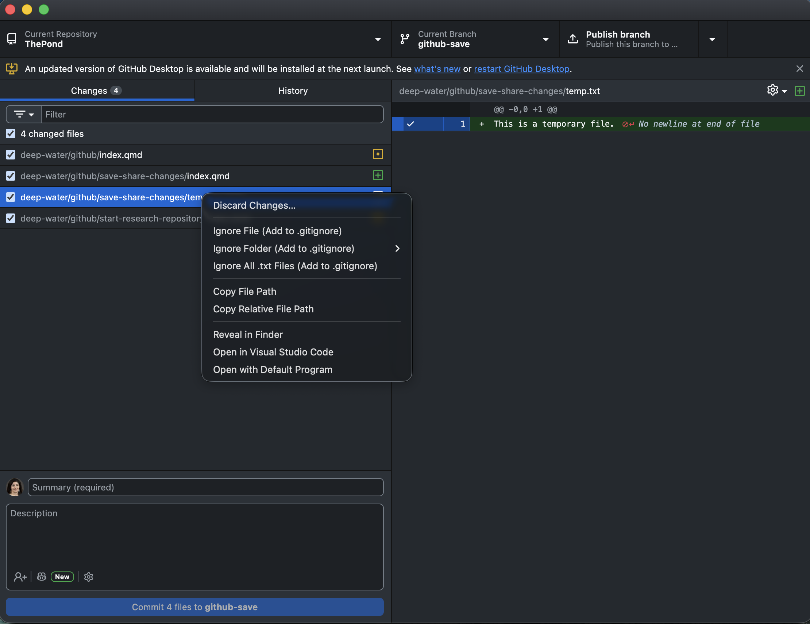
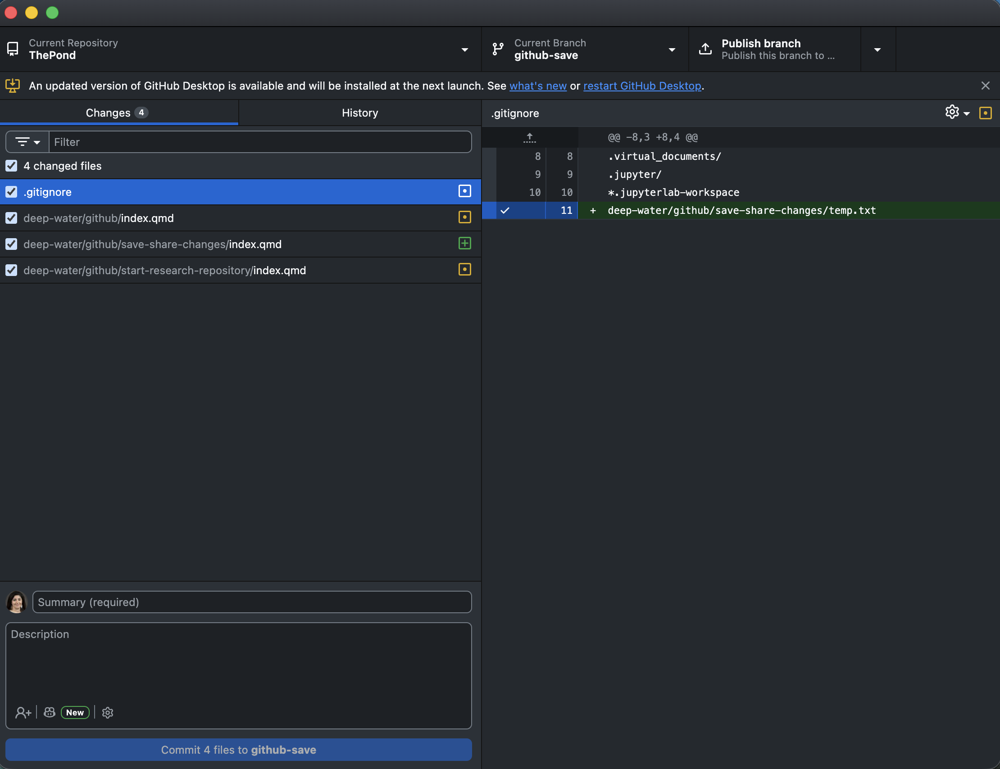
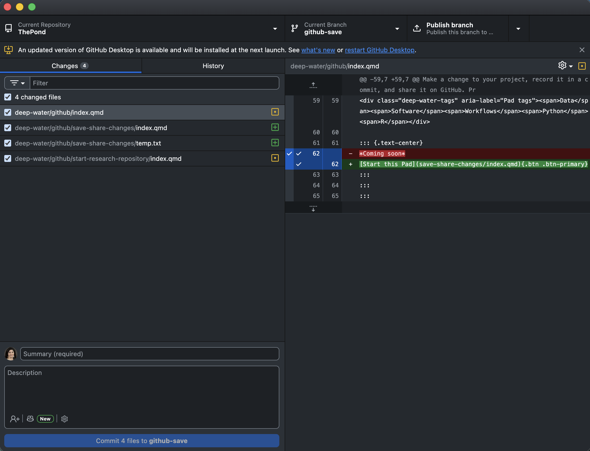

# Overview

Creating a GitHub repository is just the beginning. As your research progresses, you'll update files, refine analyses, and correct mistakes. Keeping track of these changes helps you understand how your project has evolved and makes it easier to share your work with collaborators.

In this LilyPad, you'll learn how to use [**GitHub Desktop**](https://desktop.github.com/) to manage changes to your research project, maintain a meaningful version history, and share updates on GitHub—all without using the command line.

## What you will learn

By the end of this LilyPad, you will be able to:

- Clone a GitHub repository to your computer using GitHub Desktop.
- Identify files that should not be tracked and use `.gitignore` to exclude them.
- Make and review changes to your research project.
- Create meaningful commits to document how your project evolves.
- Explore your project's history to understand what changed and when.
- Push your changes to GitHub and verify that they were shared.

**No command line required!**

## Before you begin

To complete this LilyPad, you will need:

- **[A GitHub account.](https://github.com/signup)** You should already have one from the [previous LilyPad](../start-a-research-repository/index.qmd).
- **An existing GitHub repository.** You can continue with the repository you created in [Start a Research Repository](../start-a-research-repository/index.qmd), using one of our example geoscience projects or your own research project.
- **GitHub Desktop.** You'll need to [download and install GitHub Desktop](https://desktop.github.com/) on your computer. We'll walk you through connecting it to your GitHub account.
- **A text editor.** You'll need to edit a file in your repository. You can use [VS Code](https://code.visualstudio.com/), another text editor, or your preferred development environment.

You don't need any previous experience with Git or the command line. We'll guide you through each step using GitHub Desktop.

# From GitHub to your computer

In the previous [LilyPad](../start-research-repository/index.qmd), you created a GitHub repository for your research project. You organized your files, documented your project in a README, and decided what should (and should not) be shared.

But research projects rarely stay the same. You might collect new observations, correct an error in a dataset, refine an analysis, or improve your documentation.

How can you keep track of these changes and share them without repeatedly uploading files through your browser?

**That's where Git and GitHub Desktop come in.**

In this LilyPad, you'll use [GitHub Desktop](https://desktop.github.com/) to make a copy of your repository on your computer, modify your project, record meaningful changes, and share those changes on GitHub.

::: {.callout-note title="No coding required!"}
You won't need to use the command line. We'll use GitHub Desktop throughout this LilyPad.
:::

## Your starting point

You'll continue working with the repository you created in the [previous LilyPad](../start-research-repository/index.qmd). You can use the geoscience study package you selected earlier or your own research project.

By the end of this activity, you'll have a local working copy of your repository, a record of the changes you've made, and an updated version of your project on GitHub.


## Activity 1: Bring your repository to your computer

So far, you've been working with your repository through the GitHub website. Your files live on GitHub, and you've been making changes using your browser.

But you probably don't want to edit your research notebooks, datasets, or scripts through a web browser!

Instead, we'll create a **local copy** of your repository on your computer. In Git terminology, this is called **cloning**.

Cloning a repository copies your project files **and their Git history** from GitHub to your computer.

::: {.callout-tip}
## Two copies, one project

- **Remote repository:** Your project hosted on GitHub.
- **Local repository:** Your copy of the project on your computer.

These repositories don't automatically stay synchronized. You'll learn how to share your local changes with GitHub later in this LilyPad.
:::

### Step 1: Install GitHub Desktop

If you haven't already, [download and install GitHub Desktop](https://desktop.github.com/).

Next, make sure GitHub Desktop is connected to your GitHub account:

1. Open GitHub Desktop.
2. Go to **GitHub Desktop → Settings → Accounts** (macOS) or **File → Options → Accounts** (Windows).
3. If you're not signed in, select **Sign Into GitHub.com**.
4. Follow the instructions to authenticate through your web browser. You may need to complete two-factor authentication.
5. Return to GitHub Desktop and verify that you're signed in with the account you used in the previous LilyPad.

::: {.callout-tip collapse="true"}
## Having trouble signing in?

Authentication problems can happen, especially if you've used GitHub Desktop before or have multiple GitHub accounts.

- **Wrong account?** Check that GitHub Desktop is connected to the same account you used to create your repository.
- **Browser doesn't return to GitHub Desktop?** Look for a browser prompt asking permission to open GitHub Desktop.
- **Authentication expired or failed?** Try signing out of GitHub Desktop and signing in again.
- **Using an institutional GitHub organization?** You may need additional organization authorization.

For more help, see [GitHub's authentication troubleshooting guide](https://docs.github.com/en/desktop/installing-and-authenticating-to-github-desktop/authenticating-to-github-in-github-desktop).
:::

### Step 2: Clone your repository

1. In GitHub Desktop, select **File → Clone Repository**.
2. Select the **GitHub.com** tab.
3. Find and select the repository you created in the previous LilyPad.
4. Under **Local Path**, choose where you'd like to store your project on your computer. Remember this location!
5. Click **Clone**.

GitHub Desktop will create a local copy of your repository.

### Step 3: Explore your local repository

In GitHub Desktop, select **Repository → Show in Finder** (macOS) or **Show in Explorer** (Windows).

Open the folder and take a look around.

- Can you find your `README.md`?
- Are the folders and files you uploaded in the previous LilyPad present?
- Does the folder structure match what you see on GitHub?

::: {.callout-note}
## What just happened?

You now have a local Git repository!

You can open and edit these files using your usual tools, such as JupyterLab, VS Code, or a text editor.

GitHub Desktop will help you track the changes you make and share them with GitHub.
:::


## What should Git track?

Not every file on your computer belongs in your GitHub repository.

Scientific projects often generate temporary files, caches, or application-specific files that aren't necessary to reproduce your research. Tracking these files can clutter your repository and make it harder to identify meaningful changes.

Git lets you specify which files and folders to ignore using a file called **`.gitignore`**.

For example, you might want to ignore:

- `.ipynb_checkpoints/` — automatic checkpoints created by Jupyter.
- `__pycache__/` — temporary files generated by Python.
- `.DS_Store` — metadata files created by macOS.
- `.env` — local environment settings that may contain credentials.

### Adding files to .gitignore with GitHub Desktop

You don't need to write `.gitignore` from scratch. GitHub Desktop can help you create or update it.

1. Open GitHub Desktop and select your repository.
2. Under the **Changes** tab, find a file you don't want Git to track.
3. Right-click the file and select **Ignore File (Add to .gitignore)**.



You can also ignore an entire folder or all files with a particular extension, but be careful: you might accidentally ignore files that are important to your research.

### What happens when you ignore a file?

GitHub Desktop updates `.gitignore` with a rule matching your selected file.



Notice that:

- The temporary file no longer appears in the list of changes.
- The `.gitignore` file now contains a rule identifying the file to ignore.
- `.gitignore` itself is tracked by Git, so its rules can be shared with collaborators.

::: {.callout-note collapse="true"}
## What if a file is already tracked?

`.gitignore` only prevents Git from tracking files that are not already tracked.

If you've previously committed a file, adding it to `.gitignore` will not automatically stop Git from tracking it. You must also remove it from Git's tracking, which is different from deleting the file from your computer.

Also, `.gitignore` is not a security tool. If a sensitive file was committed previously, ignoring it does not remove it from the repository's history.
:::

::: {.callout-tip}
## Check your repository

Look through the files listed under **Changes** in GitHub Desktop.

Are there any temporary or automatically generated files that shouldn't be shared? If so, consider adding them to `.gitignore`.

If everything looks good, you can move on!
:::


# Make and review changes

Research projects evolve. You might update your methods, correct an error, add new observations, or improve your documentation.

Now that you have a local repository, you can make these changes directly on your computer using your usual tools.

Git will help you keep track of what changed.

## Activity 2: Update your README

Let's start with a small change to your project documentation.

1. Open your local repository folder using Finder (macOS) or File Explorer (Windows).
2. Find your `README.md` file and open it in your preferred text editor (e.g., VS Code).
3. Make a meaningful change to your README. For example:
   - Add a short description of your project's current status.
   - Update your research objectives.
   - Add information about a dataset or analysis.
   - Correct or clarify something you wrote in the previous LilyPad.
4. **Save the file** in your text editor.

You have now modified a file in your local repository!

## See what Git noticed

Return to GitHub Desktop and select the **Changes** tab.

You should see `README.md` in the list of changed files. Select it to examine what Git detected.



GitHub Desktop uses colors and symbols to help you understand changes:

- **Green (+):** Content that was added.
- **Red (-):** Content that was removed.
- **Yellow indicator:** An existing file that was modified.
- **Green file indicator:** A new file that Git hasn't tracked before.

The display showing added and removed lines is called a **diff** (short for difference). It compares your current changes with the last committed version of the file.

Your README will look different from the example above, but the same principles apply.

::: {.callout-important}
## Saving is not committing!

When you saved your README, you updated the file on your computer.

GitHub Desktop detected the change, but it hasn't yet been recorded as a new commit in Git's history or shared with GitHub.

We'll learn how to do that next.
:::

Imagine you're revisiting an analysis you completed six months ago. The results look different, but you're not sure why.

Did you change a parameter? Correct a calculation? Remove some observations? Or simply update the documentation?

Git helps answer these questions by recording the history of your project. But to create a useful history, you first need to understand **what you're saving**.

## Activity 3: Review before you commit

Return to the **Changes** tab in GitHub Desktop.

1. Select your modified `README.md`.
2. Look at the differences displayed on the right.
3. Check that the changes match what you intended to do.
4. If you notice an error, return to your text editor, correct it, and save the file. GitHub Desktop will update automatically.

This is an opportunity to catch mistakes before recording them in your project's history.

## Which changes belong together?

You may have noticed the checkboxes next to each file in the Changes tab.

These checkboxes determine which files will be included in your next **commit** (a saved record of changes in Git).

By default, GitHub Desktop selects all changed files. You can uncheck files that you don't want to include in a particular commit.

For example, imagine you've made three changes:

- Updated your README to describe a new analysis.
- Modified a Python script to correct a calculation.
- Added some unrelated notes about a future project.

You might want to record the README and script changes together, while leaving the unrelated notes for another commit.

**Why does this matter?**

A useful Git history does more than record when files changed. It helps you understand **what changed and why**.

For scientific research, that could mean identifying when you changed a filtering threshold, corrected a unit conversion, or updated an analysis method.

::: {.callout-tip}
## Check your changes

Before moving on, make sure that:

- Your README contains the changes you intended.
- You understand what the green and red lines represent.
- The files you want to include in your next commit are checked.

If you only changed your README, that's perfectly fine!

**Don't commit anything yet.** We'll do that in the next activity.
:::


# Save your project's history

You've made changes to your README and reviewed them in GitHub Desktop. But what happens when you want to remember why you made those changes, or find out what your project looked like several months ago?

This is where **commits** come in.

A commit records a set of changes in your project's Git history. Each commit includes information about what changed, who made the change, and when it happened.

You also provide a **commit message** explaining the purpose of those changes.

## Activity 4: Create your first commit

Let's record the README changes you made earlier.

1. Return to the **Changes** tab in GitHub Desktop.
2. Make sure `README.md` is checked. If you have other changed files, uncheck any that don't belong in this commit.
3. At the bottom left, find the **Summary (required)** field.
4. Write a short message describing what you changed.
5. Optionally, use the **Description** field to explain why you made the change.
6. Click **Commit to main** (or the name of your current branch).

Congratulations! You've created a commit in your local repository.

::: {.callout-tip}
## Writing useful commit messages

A good commit message explains what you changed, rather than simply stating that something changed.

For example:

| Less useful | More useful |
|---|---|
| Update files | Document project objectives in README |
| Fix code | Correct temperature conversion from K to °C |
| Changes to analysis | Exclude stations with incomplete QC records |
| New stuff | Add preliminary stream nitrate analysis |

Try to keep each commit focused on a meaningful change or a small group of related changes.

Remember that you're writing these messages for your future self and potentially your collaborators!
:::

## Explore your project's history

Now let's see what Git recorded.

1. In GitHub Desktop, select the **History** tab.
2. Find the commit you just created. It should appear near the top of the list.
3. Select your commit.
4. Examine the files listed and click `README.md` to see the changes included in that commit.
5. Select an earlier commit to explore what was changed previously.

Notice that you can examine changes made at different points in your project's development.

This is particularly useful in scientific research. You might be able to identify when you modified a parameter, changed a data-processing method, or corrected a mistake in your analysis.

::: {.callout-note}
## What does a commit preserve?

A commit records a snapshot of the tracked files in your project, along with information about the changes introduced by that commit.

This lets you inspect earlier versions of your work and understand how your project evolved.

However, Git can only preserve changes to files that it tracks. It won't record files excluded by `.gitignore` or changes you haven't committed.
:::

## Local history versus GitHub

You've now recorded your changes in Git, but there's one important distinction:

**Your new commit exists on your computer, not yet on GitHub.**

If you visit your repository on GitHub in your browser, you won't see these latest changes.

To share your commits, you need to **push** them to GitHub.

We'll do that in the next activity.

::: {.callout-tip}
## Check your work

Before moving on:

- Find your new commit in the History tab.
- Verify that the commit message describes the change you made.
- Select the commit and inspect the recorded changes.

You now have a local record of your work!
:::


# Share your changes on GitHub

You've made changes to your research project and recorded them in your local Git history.

But if you open your repository on the GitHub website, you won't see those changes yet!

That's because **committing and sharing are two different actions**.

- **Commit:** Records changes in the Git history on your computer.
- **Push:** Sends your local commits to the remote repository on GitHub.

This separation is useful. You can work on your research, experiment, and record changes locally, even without an internet connection. When you're ready, you can share your commits with GitHub.

## Activity 5: Push your changes

Let's share the commit you created in the previous activity.

1. Open GitHub Desktop and select your repository.
2. Make sure you're on the same branch where you created your commit (typically `main`).
3. Near the top of the window, look for the **Push origin** button.
4. Click **Push origin**.

GitHub Desktop will send your local commits to GitHub.

::: {.callout-note collapse="true"}
## Don't see the Push origin button?

If GitHub Desktop displays **Fetch origin** instead, you may not have any local commits waiting to be pushed.

If you're sure you created a commit, check the History tab and verify that you're working in the correct repository and branch.

If GitHub has newer changes that aren't on your computer, you may need to pull those changes before pushing. We'll explore this in the next LilyPad on collaboration.
:::

## Verify your changes on GitHub

How do you know your changes actually made it to GitHub?

1. In GitHub Desktop, select **Repository → View on GitHub**.
2. Your repository will open in your web browser.
3. Open your `README.md`. Does it contain the changes you made locally?
4. Find the **Commits** link on the repository page and open the commit history.
5. Locate the commit you just pushed. Select it to inspect the recorded changes.

You should see the same commit message and changes that you examined in GitHub Desktop.

Your project now has a shared history that you can access from another computer or share with collaborators who have access to the repository.

## Putting it all together

You've now practiced the basic Git workflow. Can you connect each action to what it does?

Select an action on the left, then its matching description on the right. You'll get immediate feedback.

```{ojs}
//| echo: false

gitMatching = {
  const actions = [
    { id: "save", label: "Edit & save",
      description: "Update files on your computer" },
    { id: "review", label: "Review",
      description: "Inspect changes before recording them" },
    { id: "commit", label: "Commit",
      description: "Record changes in your local Git history" },
    { id: "push", label: "Push",
      description: "Send your local commits to GitHub" }
  ];

  const byId = Object.fromEntries(actions.map(a => [a.id, a]));
  const descriptionOrder = ["push", "save", "commit", "review"];

  const root = html`
    <div class="pond-match">
      <style>
        .pond-match {
          border: 1px solid #ddd;
          border-radius: 10px;
          padding: 1.2rem;
          margin: 1rem 0;
        }
        .pond-match-grid {
          display: grid;
          grid-template-columns: 1fr 1.4fr;
          gap: 1rem;
        }
        .pond-match-column {
          display: flex;
          flex-direction: column;
          gap: 0.6rem;
        }
        .pond-match-column > strong {
          margin-bottom: 0.3rem;
        }
        .pond-match-option {
          width: 100%;
          min-height: 58px;
          padding: 0.7rem;
          border: 2px solid #ddd;
          border-radius: 8px;
          background: #f8f9fa;
          color: #222;
          text-align: left;
          cursor: pointer;
          transition: background 0.15s, border-color 0.15s;
        }
        .pond-match-option:hover:not(:disabled) {
          border-color: #64748b;
        }
        .pond-match-option.is-selected {
          border-color: #2563eb;
          background: #eff6ff;
        }
        .pond-match-option.is-correct {
          border-color: #15803d;
          background: #dcfce7;
          color: #14532d;
          cursor: default;
          opacity: 1;
        }
        .pond-match-option.is-correct::after {
          content: " ✓";
          font-weight: bold;
        }
        .pond-match-option.is-wrong {
          border-color: #dc2626;
          background: #fee2e2;
          color: #991b1b;
        }
        .pond-match-option.is-wrong::after {
          content: " ✕";
          font-weight: bold;
        }
        .pond-match-feedback {
          margin: 1rem 0;
          min-height: 1.5rem;
          font-weight: 500;
        }
        .pond-match-feedback[data-result="wrong"] {
          color: #b91c1c;
        }
        .pond-match-feedback[data-result="correct"] {
          color: #15803d;
        }
        .pond-match-reset {
          padding: 0.4rem 1rem;
          border: 1px solid #aaa;
          border-radius: 6px;
          background: transparent;
          color: inherit;
          cursor: pointer;
        }
        @media (max-width: 600px) {
          .pond-match-grid {
            grid-template-columns: 1fr;
          }
        }
      </style>

      <div class="pond-match-grid">
        <div class="pond-match-column">
          <strong>Action</strong>
          <div class="pond-match-column pond-match-actions"></div>
        </div>
        <div class="pond-match-column">
          <strong>What it does</strong>
          <div class="pond-match-column pond-match-descriptions"></div>
        </div>
      </div>

      <p class="pond-match-feedback" aria-live="polite">
        Select an action, then its description.
      </p>
      <button type="button" class="pond-match-reset">
        Start over
      </button>
    </div>
  `;

  const actionButtons = new Map();
  const descriptionButtons = new Map();
  const matched = new Set();

  let selected = null;
  let wrong = null;

  const feedback = root.querySelector(".pond-match-feedback");

  function message(text, result = "") {
    feedback.textContent = text;
    feedback.dataset.result = result;
  }

  function render() {
    for (const [id, button] of actionButtons) {
      button.classList.toggle("is-selected",
        selected === id && wrong === null);
      button.classList.toggle("is-correct", matched.has(id));
      button.classList.toggle("is-wrong",
        wrong !== null && wrong.action === id);
      button.disabled = matched.has(id);
      button.setAttribute("aria-pressed", selected === id);
    }

    for (const [id, button] of descriptionButtons) {
      button.classList.toggle("is-correct", matched.has(id));
      button.classList.toggle("is-wrong",
        wrong !== null && wrong.description === id);
      button.disabled = matched.has(id);
    }
  }

  for (const action of actions) {
    const button = html`
      <button type="button" class="pond-match-option">
        ${action.label}
      </button>
    `;

    button.addEventListener("click", () => {
      selected = action.id;
      wrong = null;
      message("Now select the matching description.");
      render();
    });

    actionButtons.set(action.id, button);
    root.querySelector(".pond-match-actions").append(button);
  }

  for (const id of descriptionOrder) {
    const action = byId[id];
    const button = html`
      <button type="button" class="pond-match-option">
        ${action.description}
      </button>
    `;

    button.addEventListener("click", () => {
      if (selected === null) {
        message("Choose an action on the left first.");
        return;
      }

      if (selected === id) {
        matched.add(id);
        selected = null;
        wrong = null;

        if (matched.size === actions.length) {
          message(
            "Great work! Edit & save → Review → Commit → Push",
            "correct"
          );
        } else {
          message("Correct! Choose another action.", "correct");
        }
      } else {
        wrong = { action: selected, description: id };
        message("Not quite! Try another description.", "wrong");
      }

      render();
    });

    descriptionButtons.set(id, button);
    root.querySelector(".pond-match-descriptions").append(button);
  }

  root.querySelector(".pond-match-reset").addEventListener("click", () => {
    matched.clear();
    selected = null;
    wrong = null;
    message("Select an action, then its description.");
    render();
  });

  render();
  return root;
}
```


::: {.callout-important}
## Remember: GitHub doesn't automatically receive your changes

Saving a file does not create a commit, and creating a commit does not automatically push it to GitHub.

You decide when to record your changes and when to share them.

Only committed changes are included when you push.
:::

### Before you leave this LilyPad

You've now completed the basic Git workflow using GitHub Desktop!

Make sure you can:

- [ ] Find your local repository on your computer.
- [ ] Recognize files that Git has detected as changed.
- [ ] Use `.gitignore` when appropriate.
- [ ] Review changes before committing.
- [ ] Create a commit with a meaningful message.
- [ ] Find that commit in the History tab.
- [ ] Push your commits to GitHub.
- [ ] Verify that your changes appear on the GitHub website.

You now have the tools to maintain a version history of your research project without manually creating files named `analysis_final_v2_REALLY_FINAL.ipynb`!

::: {.callout-tip}

# What's next?

Research is rarely a solo activity. What happens when two people want to modify the same project?

In the next LilyPad, [**Collaborate on a Change**](../collaborate-change/index.qmd), you'll learn how to use GitHub to propose, review, and integrate changes made by different contributors.
:::

