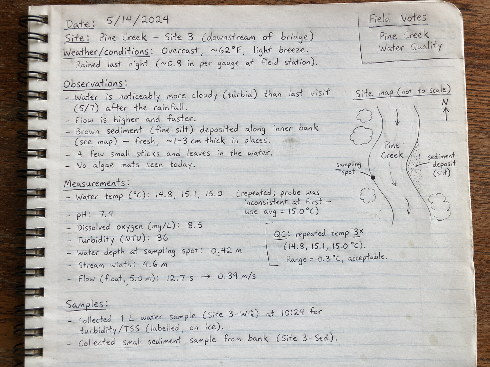

## 1. What types of data do you work with?

When we think about scientific data, we often picture a spreadsheet filled with numbers. But scientific data come in many different forms.

A climate scientist might work with temperature measurements, satellite images, and climate model outputs. A geologist might use field notes, maps, and photographs of rock samples. A biologist might work with DNA sequences, microscope images, or observations of animal behavior.

All of these contain scientific information, but they represent that information in very different ways.

### Your turn!

Think about the different types of data you encounter in your own research. These might include measurements, observations, images, maps, model outputs, or something else entirely.

**What types of data do you work with?** List a few examples and briefly describe what information they contain. Try to think beyond spreadsheets and numerical measurements.

```{ojs}
//| echo: false
viewof dataExamples = Inputs.textarea({
  label: "My research data",
  placeholder: "List the different types of data you work with...",
  rows: 6
})
```

### A question to challenge your thinking

**Is a laboratory or field notebook scientific data? Why or why not?**

There isn't necessarily a single right answer. Think about what information a notebook contains and how that information might be used in scientific research.

```{ojs}
//| echo: false
viewof notebookResponse = Inputs.textarea({
  label: "My thoughts",
  placeholder: "Is a notebook data? Explain your reasoning...",
  rows: 4
})
```

```{ojs}
//| echo: false
downloadReflection = {
  const content = [
    "# Different Types of Data — My Reflection",
    "",
    "## What types of data do I work with?",
    "",
    dataExamples || "_No response entered._",
    "",
    "## Is a laboratory or field notebook scientific data?",
    "",
    notebookResponse || "_No response entered._",
    ""
  ].join("\n");

  const url = "data:text/markdown;charset=utf-8," +
    encodeURIComponent(content);

  return html`<a class="btn btn-primary"
    href="${url}"
    download="data-types-reflection.md">
    Download my reflection
  </a>`;
}
```

---

In the next activity, we'll explore some examples of scientific data and discover how different kinds of information can be organized and represented.

## 2. Mystery datasets

Scientific data come in many different forms. But how would you describe them?

Explore the mystery datasets below. For each one, select all the terms you think describe the data, then **reveal the answer** to compare your choices with ours.

Remember: **More than one description can apply to the same dataset!**

```{=html}
<style>
.pond-dtype-card {
  max-width: 1050px;
  margin: 1.5rem auto;
  perspective: 1600px;
}

.pond-dtype-inner {
  display: grid;
  transform-style: preserve-3d;
  transition: transform 0.6s ease;
}

.pond-dtype-card.is-flipped .pond-dtype-inner {
  transform: rotateY(180deg);
}

.pond-dtype-face {
  grid-area: 1 / 1;
  padding: 1.5rem;
  border: 1px solid var(--bs-border-color, #ddd);
  border-radius: 14px;
  background: var(--bs-body-bg, white);
  backface-visibility: hidden;
  -webkit-backface-visibility: hidden;
}

.pond-dtype-back {
  transform: rotateY(180deg);
}

.pond-dtype-face h3 {
  margin-top: 0;
}

.pond-dtype-layout {
  display: grid;
  grid-template-columns: 1.15fr 1fr;
  gap: 1.5rem;
  align-items: start;
}

.pond-dtype-media {
  margin: 0;
}

.pond-dtype-media img {
  display: block;
  width: 100%;
  height: auto;
  border-radius: 8px;
}

.pond-dtype-credit {
  font-size: 0.78rem;
  color: var(--bs-secondary-color, #666);
  margin-top: 0.5rem;
}

.pond-dtype-cloud {
  display: flex;
  flex-wrap: wrap;
  gap: 0.55rem;
  margin: 1.2rem 0;
}

.pond-dtype-tag {
  border: 1px solid var(--bs-border-color, #bbb);
  background: var(--bs-tertiary-bg, #f7f7f7);
  color: var(--bs-body-color, #222);
  border-radius: 22px;
  padding: 0.5rem 0.85rem;
  cursor: pointer;
  transition: background 0.15s, border-color 0.15s;
}

.pond-dtype-tag:hover {
  border-color: var(--bs-primary, #286cc4);
}

.pond-dtype-tag[aria-pressed="true"] {
  background: var(--bs-primary, #286cc4);
  color: white;
  border-color: var(--bs-primary, #286cc4);
}

.pond-dtype-actions {
  margin-top: 1.5rem;
}

.pond-dtype-answers {
  display: flex;
  flex-wrap: wrap;
  gap: 0.5rem;
  margin: 1rem 0;
}

.pond-dtype-answer-tag {
  display: inline-block;
  padding: 0.35rem 0.8rem;
  border-radius: 20px;
  background: var(--bs-primary-bg-subtle, #e4efff);
  color: var(--bs-primary-text-emphasis, #174c87);
  font-weight: 600;
}

.pond-dtype-explanation {
  line-height: 1.65;
}

.pond-dtype-my-choice {
  color: var(--bs-secondary-color, #666);
  font-size: 0.9rem;
}

@media (max-width: 700px) {
  .pond-dtype-layout {
    grid-template-columns: 1fr;
  }
  .pond-dtype-face {
    padding: 1rem;
  }
}

@media (prefers-reduced-motion: reduce) {
  .pond-dtype-inner {
    transition: none;
  }
}
</style>

<article class="pond-dtype-card" id="dtype-notebook">
  <div class="pond-dtype-inner">

    <!-- FRONT -->
    <section class="pond-dtype-face pond-dtype-front">
      <h3>Dataset A — A field notebook</h3>

      <div class="pond-dtype-layout">

        <figure class="pond-dtype-media">
          <a href="notebook.png" target="_blank" rel="noopener">
            
          </a>
          <figcaption class="pond-dtype-credit">
            Fictional field notes. AI-generated image created with
            OpenAI for The Pond (2026). No real observations.
            Click the image to enlarge.
          </figcaption>
        </figure>

        <div>
          <p>
            A hydrologist records observations during a field visit,
            including measurements, descriptions of stream conditions,
            and a small sketch of the sampling location.
          </p>

          <p><strong>How would you describe this dataset?</strong></p>
          <p>Select all the terms you think apply.</p>

          <div class="pond-dtype-cloud"
               role="group"
               aria-label="Describe the field notebook">
            <button type="button" class="pond-dtype-tag" aria-pressed="false">Tabular</button>
            <button type="button" class="pond-dtype-tag" aria-pressed="false">Time series</button>
            <button type="button" class="pond-dtype-tag" aria-pressed="false">Spatial</button>
            <button type="button" class="pond-dtype-tag" aria-pressed="false">Multidimensional</button>
            <button type="button" class="pond-dtype-tag" aria-pressed="false">Text</button>
            <button type="button" class="pond-dtype-tag" aria-pressed="false">Image</button>
            <button type="button" class="pond-dtype-tag" aria-pressed="false">Video</button>
          </div>

          <div class="pond-dtype-actions">
            <button type="button"
                    class="btn btn-primary pond-dtype-reveal">
              Reveal answer
            </button>
          </div>
        </div>
      </div>
    </section>

    <!-- BACK -->
    <section class="pond-dtype-face pond-dtype-back" inert>
      <h3>Dataset A — What did you find?</h3>

      <p><strong>Our suggested descriptions:</strong></p>

      <div class="pond-dtype-answers">
        <span class="pond-dtype-answer-tag">Text</span>
        <span class="pond-dtype-answer-tag">Image</span>
        <span class="pond-dtype-answer-tag">Spatial</span>
      </div>

      <div class="pond-dtype-explanation">
        <p>
          <strong>Text:</strong> The notebook contains written
          observations, descriptions, and measurements.
          Much of the scientific information is conveyed
          through language.
        </p>

        <p>
          <strong>Image:</strong> We're looking at a photograph of
          handwritten notes, including a drawing. The photograph
          preserves visual information such as the handwriting,
          annotations, and layout.
        </p>

        <p>
          <strong>Spatial:</strong> The sketch conveys spatial
          relationships, including where the sample was collected
          relative to the stream and its banks. It isn't a
          georeferenced map, but it still contains spatial information.
        </p>

        <p>
          <strong>What about tabular data or time series?</strong>
          The notebook contains numerical measurements and a date,
          but the measurements are not organized into rows and
          columns or a sequence of dated observations.
          They could become part of a table or a time series
          if additional observations were collected and organized.
        </p>

        <p>
          <strong>The important idea:</strong> A single scientific
          record can combine several types of information.
          How we classify it depends partly on which characteristics
          we're interested in.
        </p>
      </div>

      <p class="pond-dtype-my-choice">
        Your choices: <span class="pond-dtype-selected"></span>
      </p>

      <button type="button"
              class="btn btn-outline-secondary pond-dtype-return">
        Back to my choices
      </button>
    </section>

  </div>
</article>

<script>
document.addEventListener("DOMContentLoaded", () => {

  document.querySelectorAll(".pond-dtype-card").forEach(card => {

    const front = card.querySelector(".pond-dtype-front");
    const back = card.querySelector(".pond-dtype-back");
    const tags = [...card.querySelectorAll(".pond-dtype-tag")];
    const reveal = card.querySelector(".pond-dtype-reveal");
    const returnButton = card.querySelector(".pond-dtype-return");

    // Select or deselect descriptions.
    tags.forEach(tag => {
      tag.addEventListener("click", () => {
        const selected = tag.getAttribute("aria-pressed") === "true";
        tag.setAttribute("aria-pressed", String(!selected));
      });
    });

    // Reveal the explanation.
    reveal.addEventListener("click", () => {
      const selected = tags
        .filter(tag => tag.getAttribute("aria-pressed") === "true")
        .map(tag => tag.textContent.trim());

      card.querySelector(".pond-dtype-selected").textContent =
        selected.length ? selected.join(", ") : "None selected";

      card.classList.add("is-flipped");
      front.inert = true;
      back.inert = false;
      returnButton.focus({preventScroll: true});
    });

    // Flip back, retaining selections.
    returnButton.addEventListener("click", () => {
      card.classList.remove("is-flipped");
      back.inert = true;
      front.inert = false;
      reveal.focus({preventScroll: true});
    });

  });

});
</script>
```
```{=html}
<article class="pond-dtype-card" id="dtype-temperature">
  <div class="pond-dtype-inner">

    <!-- FRONT -->
    <section class="pond-dtype-face pond-dtype-front">
      <h3>Dataset B — Stream temperature measurements</h3>

      <div class="pond-dtype-layout">

        <figure class="pond-dtype-media">
          <p>
            A hydrologist measures water temperature each day
            at a monitoring station.
          </p>

          <table class="table table-striped table-sm">
            <thead>
              <tr>
                <th>Date</th>
                <th>Temperature (°C)</th>
              </tr>
            </thead>
            <tbody>
              <tr><td>2026-06-01</td><td>14.2</td></tr>
              <tr><td>2026-06-02</td><td>14.8</td></tr>
              <tr><td>2026-06-03</td><td>15.1</td></tr>
              <tr><td>2026-06-04</td><td>14.9</td></tr>
              <tr><td>2026-06-05</td><td>15.4</td></tr>
              <tr><td>2026-06-06</td><td>15.7</td></tr>
            </tbody>
          </table>

          <figcaption class="pond-dtype-credit">
            Synthetic stream temperature observations created
            for The Pond (2026). No real measurements.
          </figcaption>
        </figure>

        <div>
          <p>
            The researcher wants to understand how stream
            temperature changes over time.
          </p>

          <p><strong>How would you describe this dataset?</strong></p>
          <p>Select all the terms you think apply.</p>

          <div class="pond-dtype-cloud"
               role="group"
               aria-label="Describe the stream temperature dataset">
            <button type="button" class="pond-dtype-tag" aria-pressed="false">Tabular</button>
            <button type="button" class="pond-dtype-tag" aria-pressed="false">Time series</button>
            <button type="button" class="pond-dtype-tag" aria-pressed="false">Spatial</button>
            <button type="button" class="pond-dtype-tag" aria-pressed="false">Multidimensional</button>
            <button type="button" class="pond-dtype-tag" aria-pressed="false">Text</button>
            <button type="button" class="pond-dtype-tag" aria-pressed="false">Image</button>
            <button type="button" class="pond-dtype-tag" aria-pressed="false">Video</button>
          </div>

          <div class="pond-dtype-actions">
            <button type="button"
                    class="btn btn-primary pond-dtype-reveal">
              Reveal answer
            </button>
          </div>
        </div>
      </div>
    </section>

    <!-- BACK -->
    <section class="pond-dtype-face pond-dtype-back" inert>
      <h3>Dataset B — What did you find?</h3>

      <p><strong>Our suggested descriptions:</strong></p>

      <div class="pond-dtype-answers">
        <span class="pond-dtype-answer-tag">Tabular</span>
        <span class="pond-dtype-answer-tag">Time series</span>
      </div>

      <div class="pond-dtype-explanation">
        <p>
          <strong>Tabular:</strong> The information is organized
          into rows and columns. Each row represents an observation,
          while the columns identify the date and measured temperature.
        </p>

        <p>
          <strong>Time series:</strong> The observations are associated
          with dates, allowing us to study how temperature changes
          through time. We could use these measurements to investigate
          trends, variability, or unusual temperature events.
        </p>

        <p>
          <strong>What about spatial data?</strong>
          The measurements come from a particular monitoring station,
          so they have a geographic origin. However, this dataset
          does not describe how temperature varies across different
          locations. Its primary scientific dimension is time.
        </p>

        <p>
          <strong>The important idea:</strong> Tabular and time series
          describe different characteristics of the same data.
          A table tells us how information is arranged; a time series
          tells us how observations relate to time.
          Not every table is a time series, and not every time series
          needs to be stored as a table.
        </p>
      </div>

      <p class="pond-dtype-my-choice">
        Your choices: <span class="pond-dtype-selected"></span>
      </p>

      <button type="button"
              class="btn btn-outline-secondary pond-dtype-return">
        Back to my choices
      </button>
    </section>

  </div>
</article>
```

```{=html}
<article class="pond-dtype-card" id="dtype-climate">
  <div class="pond-dtype-inner">

    <!-- FRONT -->
    <section class="pond-dtype-face pond-dtype-front">
      <h3>Dataset C — Ocean temperature from a climate model</h3>

      <div class="pond-dtype-layout">

        <figure class="pond-dtype-media">

          <svg viewBox="0 0 540 330"
               xmlns="http://www.w3.org/2000/svg"
               role="img"
               aria-labelledby="ocean-title ocean-desc"
               style="width:100%;height:auto;">

            <title id="ocean-title">
              Schematic of multidimensional ocean temperature data
            </title>
            <desc id="ocean-desc">
              Three colored grids represent ocean temperatures at
              the surface, 100 meters, and 500 meters depth.
              Each grid represents latitude and longitude.
              The example shows January, one of twelve monthly
              snapshots.
            </desc>

            <defs>
              <linearGradient id="temp-surface" x1="0" y1="1" x2="1" y2="0">
                <stop offset="0%" stop-color="#2057a5"/>
                <stop offset="40%" stop-color="#42b6bb"/>
                <stop offset="75%" stop-color="#f0d35d"/>
                <stop offset="100%" stop-color="#e77745"/>
              </linearGradient>

              <linearGradient id="temp-middle" x1="0" y1="1" x2="1" y2="0">
                <stop offset="0%" stop-color="#203b87"/>
                <stop offset="50%" stop-color="#328abe"/>
                <stop offset="100%" stop-color="#7bd0bd"/>
              </linearGradient>

              <linearGradient id="temp-deep" x1="0" y1="1" x2="1" y2="0">
                <stop offset="0%" stop-color="#182c65"/>
                <stop offset="60%" stop-color="#30599d"/>
                <stop offset="100%" stop-color="#508cba"/>
              </linearGradient>

              <pattern id="ocean-grid" width="24" height="24"
                       patternUnits="userSpaceOnUse">
                <path d="M 24 0 L 0 0 0 24"
                      fill="none" stroke="white"
                      stroke-width="1.2" opacity="0.75"/>
              </pattern>
            </defs>

            <rect x="5" y="5" width="530" height="320"
                  rx="12" fill="#f5f8fc" stroke="#dbe3eb"/>

            <text x="270" y="33" text-anchor="middle"
                  font-size="17" font-weight="600" fill="#26364a">
              Ocean temperature
            </text>

            <text x="270" y="59" text-anchor="middle"
                  font-size="13" fill="#536579">
              Time: January (one of 12 monthly snapshots)
            </text>

            <!-- Surface -->
            <text x="94" y="93" text-anchor="middle"
                  font-size="13" font-weight="600" fill="#26364a">
              Surface (0 m)
            </text>

            <rect x="34" y="108" width="120" height="120"
                  fill="url(#temp-surface)"/>
            <rect x="34" y="108" width="120" height="120"
                  fill="url(#ocean-grid)"/>

            <!-- 100 m -->
            <text x="270" y="93" text-anchor="middle"
                  font-size="13" font-weight="600" fill="#26364a">
              Depth: 100 m
            </text>

            <rect x="210" y="108" width="120" height="120"
                  fill="url(#temp-middle)"/>
            <rect x="210" y="108" width="120" height="120"
                  fill="url(#ocean-grid)"/>

            <!-- 500 m -->
            <text x="446" y="93" text-anchor="middle"
                  font-size="13" font-weight="600" fill="#26364a">
              Depth: 500 m
            </text>

            <rect x="386" y="108" width="120" height="120"
                  fill="url(#temp-deep)"/>
            <rect x="386" y="108" width="120" height="120"
                  fill="url(#ocean-grid)"/>

            <g font-size="12" fill="#536579" text-anchor="middle">
              <text x="94" y="248">Latitude × longitude</text>
              <text x="270" y="248">Latitude × longitude</text>
              <text x="446" y="248">Latitude × longitude</text>
            </g>

            <text x="270" y="282" text-anchor="middle"
                  font-size="13" fill="#26364a">
              Each grid cell represents a geographic location.
            </text>
            <text x="270" y="303" text-anchor="middle"
                  font-size="12" fill="#536579">
              Colors illustrate relative temperature (not to scale).
            </text>

          </svg>

          <figcaption class="pond-dtype-credit">
            Synthetic schematic created for The Pond (2026).
            Illustrative temperature patterns; not actual
            climate model output.
          </figcaption>
        </figure>

        <div>
          <p>
            A climate researcher analyzes monthly ocean
            temperatures from a model. The dataset contains
            temperature values organized along four dimensions:
          </p>

          <ul>
            <li>Time: 12 months</li>
            <li>Depth: 20 levels</li>
            <li>Latitude: 30 locations</li>
            <li>Longitude: 40 locations</li>
          </ul>

          <p>
            The figure shows one month at three selected depths.
            The complete dataset contains temperature values for
            every combination of the four dimensions.
          </p>

          <p><strong>How would you describe this dataset?</strong></p>
          <p>Select all the terms you think apply.</p>

          <div class="pond-dtype-cloud"
               role="group"
               aria-label="Describe the climate model dataset">
            <button type="button" class="pond-dtype-tag" aria-pressed="false">Tabular</button>
            <button type="button" class="pond-dtype-tag" aria-pressed="false">Time series</button>
            <button type="button" class="pond-dtype-tag" aria-pressed="false">Spatial</button>
            <button type="button" class="pond-dtype-tag" aria-pressed="false">Multidimensional</button>
            <button type="button" class="pond-dtype-tag" aria-pressed="false">Text</button>
            <button type="button" class="pond-dtype-tag" aria-pressed="false">Image</button>
            <button type="button" class="pond-dtype-tag" aria-pressed="false">Video</button>
          </div>

          <div class="pond-dtype-actions">
            <button type="button"
                    class="btn btn-primary pond-dtype-reveal">
              Reveal answer
            </button>
          </div>
        </div>
      </div>
    </section>

    <!-- BACK -->
    <section class="pond-dtype-face pond-dtype-back" inert>
      <h3>Dataset C — What did you find?</h3>

      <p><strong>Our suggested descriptions:</strong></p>

      <div class="pond-dtype-answers">
        <span class="pond-dtype-answer-tag">Multidimensional</span>
        <span class="pond-dtype-answer-tag">Spatial</span>
        <span class="pond-dtype-answer-tag">Time series</span>
        <span class="pond-dtype-answer-tag">Image</span>
      </div>

      <div class="pond-dtype-explanation">
        <p>
          <strong>Multidimensional:</strong> The temperature values
          are organized along four dimensions: time, depth,
          latitude, and longitude. To identify a particular
          temperature value, we need to specify a position
          along each dimension.
        </p>

        <p>
          <strong>Spatial:</strong> Latitude, longitude, and depth
          describe where temperatures occur in the ocean.
          Researchers can examine geographic patterns,
          compare regions, or investigate how temperature
          varies with depth.
        </p>

        <p>
          <strong>Time series:</strong> Because the model provides
          monthly values, we can follow how temperature changes
          through time at any particular location and depth.
          Each location can therefore have its own time series.
        </p>

        <p>
            <strong>Image:</strong> Each two-dimensional grid of
            temperature values can also be treated as an image,
            where grid cells act like pixels and temperature
            values represent pixel intensities. This allows
            researchers to apply computer vision techniques,
            such as convolutional neural networks (CNNs),
            to climate data. Additional variables, depths,
            or time steps can be represented as channels
            or sequences of images, depending on the analysis.
        </p>

        <p>
            <strong>What about tabular data?</strong>
            We could reorganize these measurements into a table,
            with columns for time, depth, latitude, longitude,
            and temperature. The scientific measurements would
            remain the same, but their organization would change.
            Some relationships that are explicit in a
            multidimensional grid would then need to be
            reconstructed from the table.
            </p>

            <p>
            <strong>The important idea:</strong> The same scientific
            dataset can be understood in several ways.
            Climate model output is multidimensional, contains
            spatial information and time series, and can be
            represented as images for certain analyses.
            How we represent data influences the tools and
            methods we can use to study them.
            </p>
      </div>

      <p class="pond-dtype-my-choice">
        Your choices: <span class="pond-dtype-selected"></span>
      </p>

      <button type="button"
              class="btn btn-outline-secondary pond-dtype-return">
        Back to my choices
      </button>
    </section>

  </div>
</article>
```

```{=html}
<article class="pond-dtype-card" id="dtype-satellite">
  <div class="pond-dtype-inner">

    <!-- FRONT -->
    <section class="pond-dtype-face pond-dtype-front">
      <h3>Dataset D — The Mississippi River Delta from space</h3>

      <div class="pond-dtype-layout">

        <figure class="pond-dtype-media">
        <a href="satellite.tif" target="_blank" rel="noopener">
            
        </a>

        <figcaption class="pond-dtype-credit">
            Real satellite imagery: NASA Earth Observatory,
            Landsat 7 (2001). Image created by Jesse Allen
            using data from the University of Maryland
            Global Land Cover Facility.
            <a href="https://science.nasa.gov/earth/earth-observatory/mississippi-river-delta-8103/"
            target="_blank" rel="noopener">
            Original source
            </a>. Click image to enlarge.
        </figcaption>
        </figure>

        <div>
          <p>
            A coastal scientist uses satellite observations to
            study the Mississippi River Delta, including the
            distribution of wetlands, water, and sediment.
          </p>

          <p>
            Satellites measure electromagnetic radiation reflected
            or emitted from Earth's surface. These measurements
            can be used to produce images like this one.
          </p>

          <p><strong>How would you describe this dataset?</strong></p>
          <p>Select all the terms you think apply.</p>

          <div class="pond-dtype-cloud"
               role="group"
               aria-label="Describe the satellite dataset">
            <button type="button" class="pond-dtype-tag" aria-pressed="false">Tabular</button>
            <button type="button" class="pond-dtype-tag" aria-pressed="false">Time series</button>
            <button type="button" class="pond-dtype-tag" aria-pressed="false">Spatial</button>
            <button type="button" class="pond-dtype-tag" aria-pressed="false">Multidimensional</button>
            <button type="button" class="pond-dtype-tag" aria-pressed="false">Text</button>
            <button type="button" class="pond-dtype-tag" aria-pressed="false">Image</button>
            <button type="button" class="pond-dtype-tag" aria-pressed="false">Video</button>
          </div>

          <div class="pond-dtype-actions">
            <button type="button"
                    class="btn btn-primary pond-dtype-reveal">
              Reveal answer
            </button>
          </div>
        </div>
      </div>
    </section>

    <!-- BACK -->
    <section class="pond-dtype-face pond-dtype-back" inert>
      <h3>Dataset D — What did you find?</h3>

      <p><strong>Our suggested descriptions:</strong></p>

      <div class="pond-dtype-answers">
        <span class="pond-dtype-answer-tag">Image</span>
        <span class="pond-dtype-answer-tag">Spatial</span>
        <span class="pond-dtype-answer-tag">Multidimensional</span>
      </div>

      <div class="pond-dtype-explanation">
        <p>
          <strong>Image:</strong> The information is represented
          as a grid of pixels. Each pixel contains information
          that contributes to our view of the river delta.
        </p>

        <p>
          <strong>Spatial:</strong> The underlying satellite observations
          correspond to geographic locations. Researchers can
          examine the distribution of wetlands, waterways,
          and sediment across the region.
        </p>

        <p>
          <strong>Multidimensional:</strong> Satellite instruments
          often measure radiation in several spectral bands.
          The underlying data can therefore have dimensions
          for position and spectral band. The image displayed
          here is a visual representation of those measurements.
        </p>

        <p>
          <strong>What about time series?</strong>
          This image represents one observation period.
          However, satellites collect observations repeatedly.
          Comparing images acquired at different times allows
          researchers to study changes in coastlines, vegetation,
          or other surface features.
        </p>

        <p>
          <strong>The important idea:</strong> An image is not
          simply a picture. It can be a representation of
          quantitative scientific measurements, with spatial
          relationships and additional dimensions.
          The underlying data may contain more information
          than is visible in the displayed image.
        </p>
      </div>

      <p class="pond-dtype-my-choice">
        Your choices: <span class="pond-dtype-selected"></span>
      </p>

      <button type="button"
              class="btn btn-outline-secondary pond-dtype-return">
        Back to my choices
      </button>
    </section>

  </div>
</article>
```