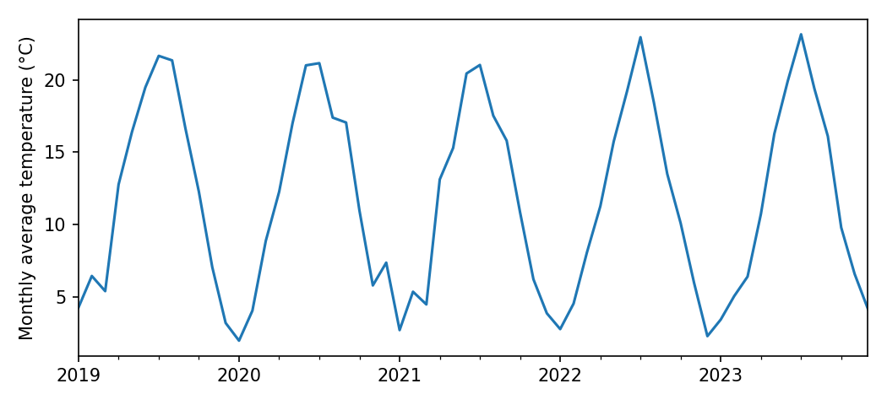
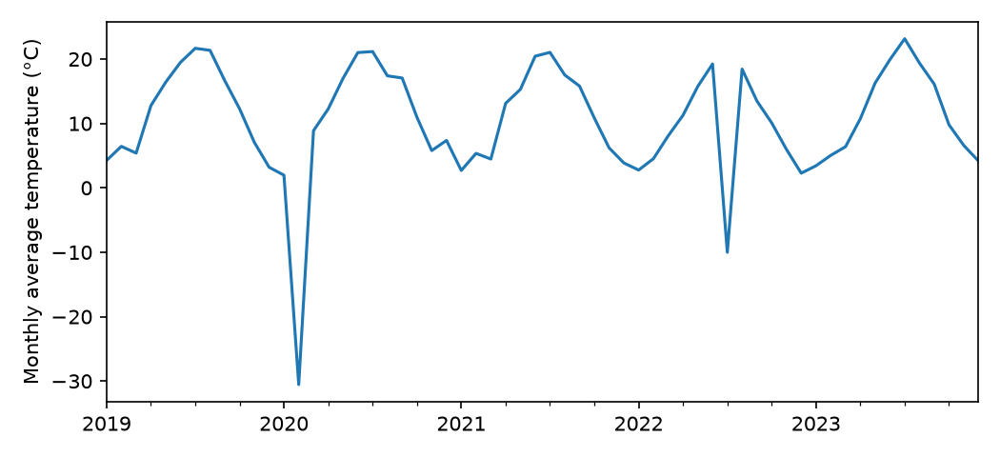

Sharing your notebook and your data is a great start. But a notebook doesn't run on its own: it runs on top of a [software stack](https://en.wikipedia.org/wiki/Solution_stack), and that stacks is always evolving. In this LilyPad, you'll see what consequences this can have for scientific reproducibility, and one popular solution to this problem.

## 1. The inherited notebook

[<i class="bi bi-clock" aria-hidden="true"></i> About 5 minutes]{.pond-md-time}

It's fall 2026, and you've just joined a lab. Your advisor asks you to extend a project that Alex, a former lab member, started: an analysis of five years (2019–2023) of daily temperatures from the lab's weather station. Before adding new years, you want to check that you can reproduce Alex's results.

Alex left you two files. The first is the data, `station_daily.csv`: one row per day, with the day's average temperature in °C. On days when the sensor failed, the temperature is recorded as `-999`:

::: {.pond-md-notes}
```
date,temp_C
2019-01-01,2.3
2019-01-02,3.6
2019-01-03,6.5
...
2020-02-11,-999.0
...
```
:::

[Fictional weather station and values, created for The Pond (2026).]{.pond-md-credit}

The second is a [Jupyter notebook](../sketches-vs-notebooks/index.qmd), saved in March 2024 with its outputs. It's written in Python and uses [pandas](https://pandas.pydata.org/), a widely used package for working with data tables. You don't need to know Python programming for this exercise: the comments (lines that start with `#`) say what each step does.

```{.python filename="Cell 1"}
# Load the tools: pandas for tables, matplotlib for plots
import pandas as pd
import matplotlib.pyplot as plt

# Read the data: one row per day
df = pd.read_csv("station_daily.csv", parse_dates=["date"], index_col="date")
```

```{.python filename="Cell 2"}
# Mark the sensor failures (-999) as missing
df["temp_C"][df["temp_C"] == -999] = None
```

::: {.pond-md-notes}
```
FutureWarning: ChainedAssignmentError: behaviour will change in pandas 3.0!
You are setting values through chained assignment. Currently this works in certain
cases, but when using Copy-on-Write (which will become the default behaviour in
pandas 3.0) this will never work to update the original DataFrame or Series [...]
Use `df.loc[row_indexer, "col"] = values` instead [...]
```
:::

```{.python filename="Cell 3"}
# Summarize: the average temperature, and the number of days below freezing
print("Average temperature (°C):", round(df["temp_C"].mean(), 2))
print("Frost days, 2019–2023:", (df["temp_C"] < 0).sum())
```

::: {.pond-md-notes}
```
Average temperature (°C): 11.77
Frost days, 2019–2023: 57
```
:::

```{.python filename="Cell 4"}
# Average the days of each month ("M"), then plot
monthly = df["temp_C"].resample("M").mean()
monthly.plot(ylabel="Monthly average temperature (°C)", xlabel="")
plt.show()
```

::: {.pond-md-notes}
```
FutureWarning: 'M' is deprecated and will be removed in a future version,
please use 'ME' instead.
```
:::

{fig-alt="Line plot of monthly average temperature from 2019 to 2023. The line rises and falls smoothly with the seasons, from about 2 °C in winter to about 23 °C in summer."}

Cells 2 and 4 printed warnings. Like most of us, Alex scrolled past them: the notebook ran, and the results looked fine. Apart from the two files, Alex left no other notes.

**Your turn!** You'll run the same notebook, on the same data. What do you expect?

```{=html}
<div class="pond-md-whatif" role="group" aria-label="Same notebook, same data: what do you expect?">
  <button type="button" class="pond-md-tag" aria-pressed="false" data-verdict="That's what most people expect: same code, same data, same numbers. Let's find out.">Exactly the same results</button>
  <button type="button" class="pond-md-tag" aria-pressed="false" data-verdict="Why would they differ? Keep your reason in mind, and let's find out.">Slightly different results</button>
  <button type="button" class="pond-md-tag" aria-pressed="false" data-verdict="A cautious guess. What could stop it? Let's find out.">It might not run at all</button>
</div>
<p class="pond-md-take" aria-live="polite" hidden></p>
```

## 2. The notebook crashes

[<i class="bi bi-clock" aria-hidden="true"></i> About 5 minutes]{.pond-md-time}

You install Python on your laptop, then pandas and matplotlib the usual way (`pip install pandas matplotlib`), which gives you their latest versions. You run the notebook. Cells 1 to 3 run. Cell 4 stops with an error:

::: {.pond-md-notes}
```
ValueError: Invalid frequency: M. Failed to parse with error message:
ValueError("'M' is no longer supported for offsets. Please use 'ME' instead.")
```
:::

**Your turn!** Code that ran for Alex fails for you. Why do you think that is?

```{=html}
<div class="pond-md-whatif" role="group" aria-label="Why does the code fail now?">
  <button type="button" class="pond-md-tag" aria-pressed="false" data-verdict="Unlikely: cells 1 to 3 read and used the data without trouble. And the error is about &quot;M&quot;, which is in the code, not in the data.">The data file is damaged</button>
  <button type="button" class="pond-md-tag" aria-pressed="false" data-verdict="Alex's notebook ran, and saved its outputs, in 2024. The code worked then. What has changed since?">Alex's code always had a bug</button>
  <button type="button" class="pond-md-tag" aria-pressed="false" data-verdict="Right. Same code, same data: the difference is the software it runs on. The message even says so: &quot;'M' is no longer supported&quot;.">The software has changed</button>
  <button type="button" class="pond-md-tag" aria-pressed="false" data-verdict="It happens, but this message is specific: &quot;'M' is no longer supported&quot;. That's the software telling you that it changed.">Something is wrong with my computer</button>
</div>
<p class="pond-md-take" aria-live="polite" hidden></p>
```

You email Alex, who finds the old laptop and checks: in March 2024, they used **pandas 2.2.1**. Your laptop has **pandas 3.1.1**. In between, pandas 3.0 ([released in January 2026](https://pandas.pydata.org/docs/whatsnew/v3.0.0.html)) stopped accepting `"M"` to mean "month", in favor of `"ME"` ("month end").

Here, the error message says what to do. You follow pandas' suggestion, change `"M"` to `"ME"` in Cell 4, and the cell runs.

This is a **gross failure**: code that ran with one version of the software doesn't run with another. It's annoying, but it's honest: you *know* that something is wrong, and the error message often tells you how to fix it.

In fact, pandas had warned Alex. Scroll back up to Cell 4: in 2024, it printed "`'M' is deprecated and will be removed in a future version, please use 'ME' instead`". *Deprecated* means "still works, but will be removed": the developers' way of giving users time to update their code.

### Key takeaway 2

Software changes over time, and code that ran yesterday can stop running today. An error is frustrating, but at least it tells you that something is wrong.

## 3. It runs! Are we done?

[<i class="bi bi-clock" aria-hidden="true"></i> About 8 minutes]{.pond-md-time}

With that change, the notebook runs to the end. Here is what Cell 3 prints on your laptop:

::: {.pond-md-notes}
```
Average temperature (°C): 10.66
Frost days, 2019–2023: 59
```
:::

**Your turn!** Scroll up and compare with Alex's results. Did you reproduce them?

```{=html}
<div class="pond-md-whatif" role="group" aria-label="Did you reproduce Alex's results?">
  <button type="button" class="pond-md-tag" aria-pressed="false" data-verdict="Look again: 10.66 °C instead of 11.77 °C, and 59 frost days instead of 57.">Yes, exactly</button>
  <button type="button" class="pond-md-tag" aria-pressed="false" data-verdict="Tempting: 1.1 °C and 2 frost days out of 1,826 days look small. But same code and same data should give the same numbers. And 1.1 °C is about how much Earth's average surface temperature has risen since the late 1800s: not a small number for a climate scientist.">Close enough</button>
  <button type="button" class="pond-md-tag" aria-pressed="false" data-verdict="Right: same data, (almost) same code, different numbers. The average is 1.1 °C lower, and there are 2 more frost days.">No</button>
</div>
<p class="pond-md-take" aria-live="polite" hidden></p>
```

**Your turn!** Which result is right?

```{=html}
<div class="pond-md-whatif" role="group" aria-label="Which result is right?">
  <button type="button" class="pond-md-tag" aria-pressed="false" data-verdict="Maybe, but how would you know? Alex's result is older, not necessarily better.">Alex's (2024)</button>
  <button type="button" class="pond-md-tag" aria-pressed="false" data-verdict="Maybe, but how would you know? Your software is newer, not necessarily better.">Mine (2026)</button>
  <button type="button" class="pond-md-tag" aria-pressed="false" data-verdict="Right: from the numbers alone, you can't tell. Both came from the same data and code. You need to look more closely.">I can't tell</button>
</div>
<p class="pond-md-take" aria-live="polite" hidden></p>
```

Let's look more closely. Here is the plot from Cell 4, on your laptop:

{fig-alt="Line plot of monthly average temperature from 2019 to 2023. The line rises and falls with the seasons, but drops to about −30 °C in February 2020 and to about −10 °C in July 2022."}

```{=html}
<div class="pond-md">
  <label for="pond-ct-notice"><strong>What do you notice? Compare it with Alex's plot.</strong></label>
  <textarea id="pond-ct-notice" class="pond-md-response pond-md-save" rows="3"
    placeholder="Anything odd?"></textarea>
</div>
```

<details class="pond-md-reveal">
<summary>Compare with our answer</summary>

Your plot has two dips that Alex's doesn't: an average of about **−30 °C in February 2020**, and of about **−10 °C in July 2022**, in the middle of summer. These are the two sensor failures, recorded as `-999`.

Cell 2 was supposed to mark them as missing. With pandas 2, it did. With pandas 3, the very same line **silently does nothing**. So the two `-999` values stayed in the data:

- they pulled the **average** down, from 11.77 °C to 10.66 °C;
- and since −999 is below 0, they were each counted as a **frost day**: 57 + 2 = 59.

**Why?** Cell 2 is unchanged, and it still says what it means. What changed is how pandas carries out this kind of instruction. With pandas 3, Cell 2 cleans a temporary *copy* of the temperatures, which is then thrown away, and the table itself is left untouched. It's like copying a column of a spreadsheet into a new sheet, cleaning it there, and never pasting it back. Nothing in Alex's code is wrong: the software underneath it changed.

Did pandas warn anyone? Yes, twice. In 2024, Cell 2 warned Alex that this way of writing would stop working in pandas 3.0, and suggested another (scroll back up to see). In 2026, Cell 2 printed:

::: {.pond-md-notes}
```
ChainedAssignmentError: A value is being set on a copy of a DataFrame or Series through chained assignment.
```
:::

Despite its name, this is a *warning*, not an error: pandas reports it, then carries on, so the notebook runs to the end. The warning was there in both years; it was just easy to ignore.

Here, Alex's result is the right one. You can tell only because the convention was written down: on days when the sensor failed, the temperature is recorded as `-999`. Without that note, nothing would tell you that −999 isn't a (very odd) measurement. This is why the way missing values are coded must be flagged in the metadata, as you saw in [Metadata for Reuse](../../data/metadata/index.qmd#missing-values), and why records of failed readings are part of the evidence behind the data, as you saw in [Data Quality and Provenance](../../data/data-quality/index.qmd#how-could-we-do-better). In a real project, the clue may be far less visible.

</details>

This is a **silent failure**: the code runs, and the numbers look plausible, but they have changed. It's far more dangerous than a crash, because nothing stops you from publishing them. Here, the plot gave it away; a table of averages wouldn't have.

### What could Alex have done?

**Your turn!** Alex's 2024 run printed two warnings (under Cells 2 and 4), each saying that pandas would soon behave differently. What could Alex have done to protect the results? Pick the options you'd recommend, then reveal our take.

::: {#pond-ct-need-warnings .pond-md-need data-yes="Helps" data-no="Risky" data-button="Reveal our take"}
::: {.pond-md-option data-name="Ignore the warnings"}
That's what Alex did, and it's what most of us do. The code did run, and gave the right numbers, in 2024. The warnings were about the future: your present.
:::

::: {.pond-md-option data-name="Turn warnings off"}
A common habit in notebooks, to keep the output tidy. It hides the only clue you would have had in 2026.
:::

::: {.pond-md-option data-name="Implement pandas' suggested changes" data-needed="true"}
It would have worked, this time. But it only covers the changes that pandas had announced by 2024. pandas, or any other package, may change again, and the updated code could then break, loudly or silently. It also means that someone has to keep updating the notebook, for as long as anyone uses it.
:::

::: {.pond-md-option data-name="Share the computational environment" data-needed="true"}
The general solution. Record exactly which software, and which versions, the notebook ran with, and share that record with the notebook. Then anyone can rerun the notebook as it ran in 2024, whatever pandas does next, without changing a line of code. More on this below.
:::
:::

### Key takeaway 3

The most dangerous failure is a silent one: the code runs, the numbers look plausible, but they have changed. Updating the code can deal with the changes announced so far, but not with those to come. Sharing the computational environment lets anyone rerun the code exactly as it ran.

## 4. What should Alex have shared?

[<i class="bi bi-clock" aria-hidden="true"></i> About 6 minutes]{.pond-md-time}

Alex shared the notebook and the data. **Your turn!** What else would you need to reproduce Alex's results exactly, in 2026 or in 2036?

::: {#pond-ct-need-env .pond-md-need}
::: {.pond-md-option data-name="The version of pandas" data-needed="true"}
The package that changed in this story.
:::

::: {.pond-md-option data-name="The versions of all other packages" data-needed="true"}
pandas relies on [NumPy](https://numpy.org/) for its arithmetic, and the plot uses [matplotlib](https://matplotlib.org/). Any of them can change too.
:::

::: {.pond-md-option data-name="The version of Python" data-needed="true"}
Old versions of packages often can't be installed on a newer Python, and new versions of packages drop support for older Pythons.
:::

::: {.pond-md-option data-name="The operating system" data-needed="true"}
Often overlooked. Most Python code behaves the same on Windows, macOS and Linux, but not always: some packages rely on parts of the operating system, which change too.
:::

::: {.pond-md-option data-name="The date Alex ran the notebook"}
A useful clue: it lets you guess which versions were current at the time. But a guess isn't a record.
:::

::: {.pond-md-option data-name="The brand of Alex's laptop"}
Irrelevant, almost always: what matters is the software, not the hardware.
:::

::: {.pond-md-meta}
**Alex's computational environment**, as Alex reconstructed it from the old laptop:

```
# Python 3.12, on macOS
pandas==2.2.1
numpy==1.26.4
matplotlib==3.8.3
```

This short text file, usually called `requirements.txt`, lists each package and its exact version (`==` *pins* the version). With it, anyone can rebuild Alex's environment with a single command, `pip install -r requirements.txt`. We did: in that environment, Alex's original notebook gives exactly Alex's numbers, with no crash and without changing a line of code. That will stay true whatever pandas does next.

A `requirements.txt` file can't install Python itself, or the operating system. Two other tools go further:

- **An environment file** (e.g. `environment.yml`, for the [conda](https://docs.conda.io/) package manager) can also pin the version of Python.
- **A container** packages *everything*: the operating system, Python, and every package, in a single *image* that runs the same way on any computer, today or in ten years. Services such as [Binder](https://mybinder.org/) build one from your repository and run your notebooks in a web browser, with nothing to install.
:::
:::

All of this, the operating system, Python, and every package with its version, is called the **computational environment**. It is as much a part of a workflow as the code and the data.

To learn how to describe your environment, share it with Binder, and build a container, dive into [Containers](../../../deep-water/containers/index.qmd) in the Deep End.

### Key takeaway 4

A notebook and its data are not enough to reproduce a result: share the computational environment too. At a minimum, list every package with its exact version; to capture everything, use a container.

## 5. Your turn

[<i class="bi bi-clock" aria-hidden="true"></i> About 4 minutes]{.pond-md-time}

**Your turn!** Think of an analysis you've done, with code, a spreadsheet, or a program with menus and buttons. If someone redid it in three years, what might have changed underneath it?

```{=html}
<div class="pond-md">
  <label for="pond-ct-reflect"><strong>What might change under my analysis</strong></label>
  <textarea id="pond-ct-reflect" class="pond-md-response pond-md-save" rows="5"
    placeholder="List the software, versions, or settings your analysis depends on..."></textarea>
</div>
```

<details class="pond-md-reveal">
<summary>Compare with our answer</summary>

- **Packages and libraries**, as in this LilyPad: in Python, R, MATLAB, Julia, and others.
- **The programming language itself**: Python 3.12 and Python 3.14 are not the same.
- **Spreadsheets and programs with menus**: many update themselves automatically, so you may not even know which version you used. Write it down (it's usually under "About").
- **Online tools and services**, which can change at any time without notice, or disappear.
- **Default settings**: a new version may change a default, such as the number of decimals, how missing values are handled, or which method is used, without you changing a thing.
- **The operating system**, and the libraries that come with it.

</details>

### So, did you reproduce Alex's results?

<details class="pond-md-reveal pond-ct-recap">
<summary>Compare the three runs</summary>

| | Alex, 2024 (pandas 2.2.1) | You, latest pandas (3.1.1) | You, with Alex's environment |
| :--- | :--- | :--- | :--- |
| Cell 4 (monthly plot) | Runs, with a warning | **Crashes**, until you implement pandas' suggested change | Runs, with no change to the code |
| Average temperature | 11.77 °C | **10.66 °C** | 11.77 °C |
| Frost days | 57 | **59** | 57 |

Only by knowing Alex's environment could you rerun the notebook as it was, and confirm which numbers were right.

</details>

### Key takeaway 5

> Software changes, sometimes loudly (the code no longer runs) and sometimes silently (the code runs, but the numbers change). To make a workflow reproducible, share the computational environment along with the code and the data. (And if you have time, read the warnings your software gives you!)

## Try it yourself (optional)

If you know some Python, you can rerun both versions yourself. Download the [data](notebook/station_daily.csv), [Alex's notebook](notebook/station_analysis.ipynb), and the two environments: [Alex's (2024)](notebook/requirements-2024.txt) and [ours (2026)](notebook/requirements-2026.txt). Then, for each environment, create a separate Python 3.12 [virtual environment](https://docs.python.org/3/library/venv.html), install the packages with `pip install -r requirements-2024.txt` (or `-2026`), and run the notebook in it.

---

Now that you know what it takes to rerun a workflow, how do you get credit for it? That's the subject of the next LilyPad, [Citing Workflows](../citing-workflows/index.qmd).

```{=html}
<div class="pond-md">
  <p>Keep a record of your answers, side by side with ours, and the key takeaways.</p>
  <button type="button" class="btn btn-primary" id="pond-ct-download">Download response summary</button>
</div>
```

```{=html}
<script src="../../../scripts/response-summary.js"></script>
<script src="../../../scripts/pond-activities.js"></script>
<script>
document.addEventListener("DOMContentLoaded", () => {
  const state = Pond.store("pond-containers");
  Pond.textBoxes(state);
  Pond.whatifs(state);
  const needs = Pond.needBanks(state);
  Pond.restore(state, needs);

  // ---------- Response summary (shared builder in scripts/response-summary.js) ----------

  // A text box, then the "Compare with our answer" panel that follows it
  function answerMd(box) {
    const label = document.querySelector(`label[for="${box.id}"]`);
    let s = `**${label ? label.textContent.trim() : "My answer"}**\n\n${box.value.trim() || "*No response entered.*"}`;
    const ours = box.closest(".pond-md").nextElementSibling;
    if (ours && ours.matches("details.pond-md-reveal")) s += "\n\n**Our answer:**\n\n" + PondSummary.blockMd(ours);
    return s;
  }

  PondSummary.attach({
    button: document.getElementById("pond-ct-download"),
    filename: "containers-response-summary.md",
    title: "Why Containers Matter",
    idea: "Sharing your notebook and your data is a great start. But a notebook doesn't run on its own: it runs on top of software, and that software keeps changing.",
    next: { text: "Citing Workflows", href: "../citing-workflows/index.html" },
    handlers: [
      { selector: ".pond-md-need", md: el => Pond.needMd(needs.find(n => n.bank === el)) },
      { selector: "textarea.pond-md-save", md: answerMd },
      { selector: ".pond-ct-recap", md: el => PondSummary.blockMd(el) }
    ]
  });
});
</script>
```
